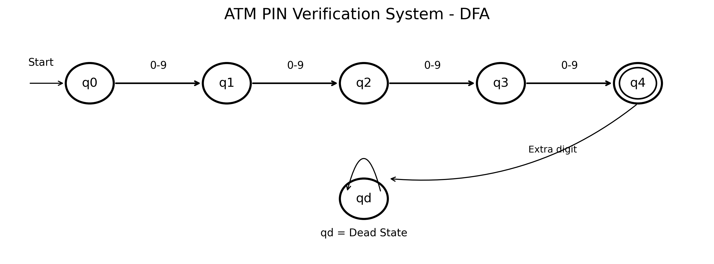

# ATM PIN Verification System Using DFA

## Project Overview

The ATM PIN Verification System is a simple application developed using the concept of a **Deterministic Finite Automaton (DFA)**.

The main purpose of this project is to check whether an entered ATM PIN follows the required four-digit numeric format. The system processes the input digit by digit and determines whether the PIN is accepted or rejected based on the DFA state transitions.

This project demonstrates how automata theory can be applied to a real-world input validation problem.

## Problem Statement

ATM systems require users to enter a PIN before accessing banking services. In this project, a DFA is designed to validate whether the entered PIN contains exactly four numeric digits.

The system accepts a PIN only if it contains four digits from 0 to 9. Inputs with fewer digits, extra digits, alphabets or special characters are rejected.

**Note:** This project validates the PIN format only. It does not check whether the PIN matches an actual bank account.

## Objectives

- To understand the practical application of DFA.
- To design a DFA for four-digit PIN format validation.
- To implement the DFA using Python.
- To test the system with valid and invalid inputs.
- To demonstrate how automata theory is used in input validation.

## DFA Design

The DFA consists of the following states:

| State | Description |
|---|---|
| q0 | Initial state |
| q1 | One digit received |
| q2 | Two digits received |
| q3 | Three digits received |
| q4 | Four digits received (Final state) |
| qd | Dead state |

**Start State:** q0

**Final State:** q4

**Input Alphabet:** Σ = {0, 1, 2, 3, 4, 5, 6, 7, 8, 9}

### DFA State Diagram

## Working Principle

1. The system starts from state q0.
2. When the first digit is entered, it moves to q1.
3. The second digit moves it to q2.
4. The third digit moves it to q3.
5. The fourth digit moves it to q4.
6. If another digit is entered, the machine moves to the dead state qd.
7. Invalid characters also lead to rejection.
8. If the input ends at q4, the PIN format is accepted.

## Technologies Used

- Python
- Google Colab
- Matplotlib
- Pandas

## Sample Test Cases

| Input | Expected Result |
|---|---|
| 1234 | Accepted |
| 5678 | Accepted |
| 0000 | Accepted |
| 123 | Rejected |
| 12345 | Rejected |
| 12AB | Rejected |
| ABCD | Rejected |
| 12 4 | Rejected |

## How to Run the Project

1. Download the `ATM_PIN_VERIFICATION_DFA.ipynb` notebook from this repository.
2. Open [Google Colab](https://colab.research.google.com/).
3. Upload the downloaded notebook.
4. Run the code cells in sequence.
5. Enter a sample PIN in the interactive demonstration.
6. Observe whether the PIN format is accepted or rejected.

## Project Files

- `ATM_PIN_VERIFICATION_DFA.ipynb` – Python implementation and demonstration.
- `ATM_PIN_DFA_Diagram.png` – DFA state transition diagram.

## Conclusion

This project helped demonstrate the practical use of Deterministic Finite Automata in validating input formats
